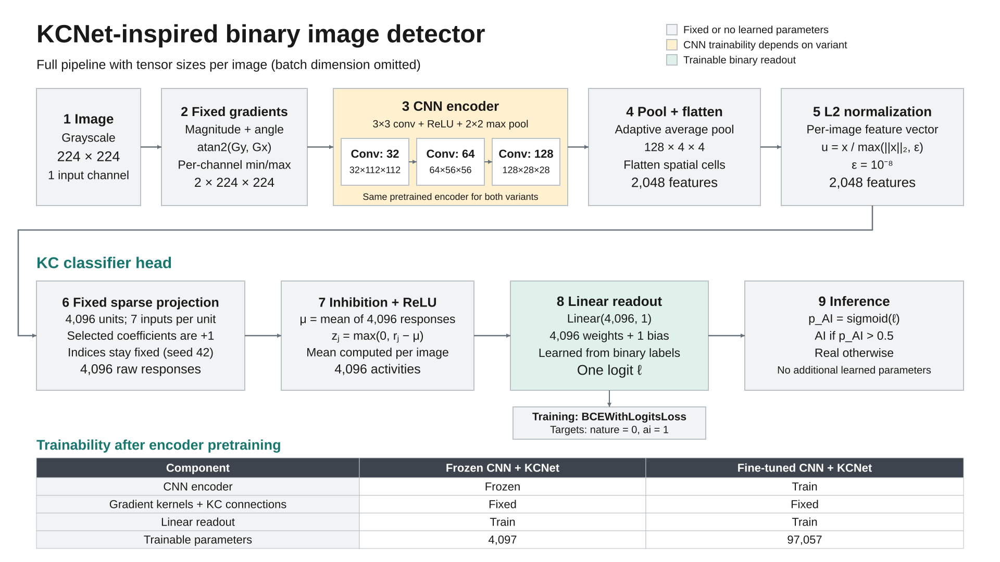

# The KC model in this research project

This guide explains the implemented binary image detector, using the default
224-pixel input, 4x4 pooling, 4,096 Kenyon units and seven inputs per unit.
It describes the code checked on 13 October 2026.

Read this file first. Then use [the equations and worked examples](KCNET_MATH_AND_EXAMPLES.md)
to understand the calculations and backpropagation. The concise specification is
in [METHOD](METHOD.md), and existing training commands are in
[EXPERIMENTS](EXPERIMENTS.md).

## 1. What the model does

The model first turns an image into CNN features. It then forms many fixed random
combinations of those features, suppresses combinations with below-average
responses, and learns how the remaining responses predict real versus generated
images.

The KC part is a **classifier head applied to CNN features**. It replaces the
original large dense classifier. It does not replace the CNN with random filters.



The [editable draw.io source](figures/kcnet_model.drawio) contains two pages:
**Architecture overview** and **KC projection detail**. Open it in draw.io to
edit the boxes, labels and connected arrows. The
[architecture SVG](figures/kcnet_architecture.svg) and
[projection-detail SVG](figures/kcnet_projection_detail.svg) are scalable exports
for documents and slides. The figures use default model dimensions.

Here, a *Kenyon unit* means one element of the expanded hidden representation.
It receives seven selected feature values. The name follows the insect-inspired
KCNet literature; it does not mean the project simulates a biological cell.
The original KCNet paper describes sparse random binary connections, inhibition
and a learned output mapping. See [Hong and Pavlic, KCNet](https://arxiv.org/abs/2108.07554).

## 2. Two KC variants, one architecture

Both model identifiers instantiate `FixedFilterKCNet`. The `train_cnn` argument
controls whether the CNN receives parameter updates.

| Component | `fixed_filter_kcnet` | `finetuned_cnn_kcnet` |
|---|---|---|
| Two gradient kernels | Fixed | Fixed |
| Three CNN blocks | Frozen after encoder pretraining | Fine-tuned |
| Adaptive average pooling | No learned parameters | No learned parameters |
| L2 normalization | No learned parameters | No learned parameters |
| Random projection indices | Fixed | Fixed |
| Mean inhibition and ReLU | No learned parameters | No learned parameters |
| Linear readout weights and bias | Train | Train |
| Trainable parameters at defaults | 4,097 | 97,057 |

**Fine-tuning the CNN does not make the gradient filters trainable.** The separate
`learned_filter_cnn` model learns the 18 gradient-filter coefficients. This
distinction matters when describing the advisor's filter-learning recommendation.

## 3. Input and fixed gradient frontend

The loader converts an image to grayscale, resizes its shorter side to 224 while
preserving its aspect ratio, takes a 224x224 center crop and converts it to a
tensor. A batch has shape `[B, 1, 224, 224]`, with intensities normally in `[0, 1]`.
The supported preset is `gray_center_224`.

The model applies the gradient frontend internally. Feeding it already-computed
gradient maps would apply the frontend twice and would also violate its expected
one-channel input.

The fixed kernels match the existing implementation:

```text
Kx = [[0,  0, 0],    Ky = [[0, -1, 0],
      [0, -1, 1],          [0,  1, 0],
      [0,  0, 0]]          [0,  0, 0]]
```

Convolution produces horizontal and vertical responses. The frontend converts
them into **magnitude and one angle channel**, then normalizes each channel
independently for each image. The resulting shape is `[B, 2, 224, 224]`.

The exact implementation uses an epsilon-stabilized magnitude, safeguarded
`atan2(Gy, Gx)` for direction, and zero outputs for effectively constant maps.
The name `LearnedGradientFrontend` is shared with the learned-filter experiment,
but KC constructs it with `trainable=False`. Its vertical convention and angle
calculation differ from the paper's written FFD/arctan expressions. See
[the implementation specification](METHOD.md) for those distinctions.

## 4. The CNN encoder and tensor sizes

Each block contains a 3x3 convolution with stride 1 and padding 1, ReLU, and 2x2
max pooling. Convolution preserves spatial size; max pooling halves it.

| Stage | Batch shape | What changes |
|---|---|---|
| Raw grayscale input | `[B, 1, 224, 224]` | One intensity channel |
| Gradient frontend | `[B, 2, 224, 224]` | Magnitude and angle |
| CNN block 1 | `[B, 32, 112, 112]` | 32 channels and first max pool |
| CNN block 2 | `[B, 64, 56, 56]` | 64 channels and second max pool |
| CNN block 3 | `[B, 128, 28, 28]` | 128 channels and third max pool |
| Adaptive average pool | `[B, 128, 4, 4]` | Coarse spatial representation |
| Flatten | `[B, 2048]` | `128 * 4 * 4 = 2048` |
| L2 normalization | `[B, 2048]` | Rescale each image's feature vector |
| Gather selected features | `[B, 4096, 7]` | Seven inputs for each KC unit |
| Sum selected features | `[B, 4096]` | One response per KC unit |
| Mean inhibition and ReLU | `[B, 4096]` | Input-dependent sparse activity |
| Linear readout | `[B, 1]` | One logit per image |

`B` is batch size. These dimensions describe the default configuration, not every
possible `--kc-pool-size` or `--kc-units` setting.

### Why average pool to 4x4?

Without the new pooling step, flattening the final feature map gives
`128 * 28 * 28 = 100,352` values. Pooling reduces that to 2,048 while retaining
16 coarse spatial locations per channel. It retains more spatial information
than reducing every channel to a single global average.

This compression also changes the representation relative to the original
classifier. A performance difference therefore cannot be attributed only to the
random KC connections.

### Why L2-normalize?

L2 normalization reduces differences caused solely by the overall scale of a
feature vector. For vectors above the numerical floor, their norm becomes one.
Their relative feature values still differ between images. This is distinct from
the earlier per-channel spatial min/max normalization of the gradient maps.

The norm floor is `1e-8`. A zero feature vector remains zero, rather than causing
division by zero. Very small vectors divided by the floor need not have norm one.

## 5. The random projection

At construction time, each of 4,096 KC units selects seven **distinct** indices
from the 2,048 input features. Selection is without replacement within a unit.
Different units may share selected features or even have the same set.

For an illustrative unit, the selected zero-based indices could be:

```text
[3, 18, 207, 511, 900, 1200, 1984]
```

That unit adds those seven normalized feature values. Each selected connection
has coefficient `+1`; every unselected connection is implicitly zero. There is
no learned projection bias and no division by seven in the implementation.
This index list is an example, not a connection list extracted from a run.

The default projection seed is 42. The model samples the indices once, saves them
as a checkpoint buffer, and reuses them for every image and epoch. Random
selection does not happen again on every forward pass. The training seed and
projection seed are separate options.

### Sparse connectivity and sparse activity are different

Sparse connectivity means seven selected connections per unit:

```text
4,096 * 7 = 28,672 selected connections
7 / 2,048 = approximately 0.342% of possible connections per unit
```

Sparse activity concerns how many KC outputs remain positive after inhibition
and ReLU. The current code does not enforce a top-k count or a 5% active fraction.
The two kinds of sparsity should be reported separately.

### Why store indices?

An explicit dense float32 projection matrix would have shape `[4096, 2048]` and
occupy 32 MiB. The stored int64 indices have shape `[4096, 7]` and occupy 224 KiB.
These are storage comparisons for the projection alone, not total model memory
or training VRAM measurements. Gathering selected values creates intermediate
tensors whose size also depends on batch size.

## 6. Mean inhibition and ReLU

For one image, the projection produces 4,096 responses. The model computes their
mean, subtracts that mean from each response, and clips negative results to zero.
The mean is over units of the **same image**, not over images in the batch.

For a miniature example with only three units:

```text
Responses:          [ 0.20, 0.50, 0.80 ]
Mean:                 0.50
Centered responses: [-0.30, 0.00, 0.30 ]
After ReLU:         [ 0.00, 0.00, 0.30 ]
```

Above-average responses survive. Below-average responses become zero. ReLU
changes the representation nonlinearly, allowing the readout to use combinations
of features rather than only their original values. This is a possible modeling
benefit, not a guarantee of better accuracy.

The centered responses sum to zero before ReLU. The rectified outputs generally
do not. If all responses are equal, all rectified outputs are zero, and the
readout's bias alone determines that image's logit.

## 7. The binary readout

`nn.Linear(4096, 1)` learns 4,096 weights and one bias. Positive and negative
readout weights let different KC activities push the logit toward either class.
The single output is a **logit**, not a probability.

Training uses `BCEWithLogitsLoss` with labels `nature = 0` and `ai = 1`.
The loss handles the sigmoid transformation internally. At evaluation,
`sigmoid(logit)` is the AI probability. The supported rule predicts AI when that
probability is strictly greater than 0.5, equivalently when the logit is greater
than zero. Exactly 0.5 is assigned to the real class.

The trainer uses AdamW and gradient clipping. Validation BCE selects the
checkpoint, and the held-out test set supplies final evaluation. See
[FULL_TRAINING](FULL_TRAINING.md) for the active queue's settings.

## 8. How a fixed layer can pass gradients

Fixed parameters and zero input gradients are different concepts. For the simple
fixed operation `r = x1 + x2`, each input derivative is one even though the
coefficients never change. The same principle applies to the KC sums.

In the fine-tuned variant, gradients propagate from the loss through the readout,
ReLU, mean subtraction, feature summation, normalization and pooling to the CNN.
The CNN can learn feature values suited to the fixed KC head. The connection
indices themselves are discrete buffers and do not receive gradients.

In the frozen variant, `encode()` disables gradient recording for the encoder
path, and CNN parameters have `requires_grad=False`. The readout remains outside
that disabled path and still trains. Evaluation disables gradients in both
variants. Setting a module to `eval()` alone is not what freezes its parameters.

Mean inhibition couples the units: changing one raw response changes the mean
used by every unit. An inactive KC output can therefore still correspond to a
raw response that receives a gradient through the mean. The exact derivative and
an example are in [the math guide](KCNET_MATH_AND_EXAMPLES.md#6-backpropagation-through-the-fixed-head).

## 9. Parameter counts

These counts include convolution/readout biases and both fixed gradient kernels.
Projection indices and numerical buffers are not counted as neural parameters.

| Component | Calculation | Parameters |
|---|---|---:|
| Gradient kernels | `2 * 3 * 3` | 18 |
| Conv 1 | `32 * 2 * 3 * 3 + 32` | 608 |
| Conv 2 | `64 * 32 * 3 * 3 + 64` | 18,496 |
| Conv 3 | `128 * 64 * 3 * 3 + 128` | 73,856 |
| CNN subtotal | Sum of three convolutions | 92,960 |
| Readout | `4096 * 1 + 1` | 4,097 |
| Total KC model | `18 + 92960 + 4097` | 97,075 |

Frozen KC trains only 4,097 parameters. Fine-tuned KC trains
`92,960 + 4,097 = 97,057`; the 18 filter coefficients remain fixed.
For general pool size `p` and KC width `K`, the feature count is `128 * p^2`
and the readout has `K + 1` parameters.

The original fixed-filter CNN has 12,946,483 parameters at 224 pixels, mostly in
its dense classifier. Replacing that classifier and adding pooling substantially
reduces parameter count. It does not by itself establish better generalization
or a measured speed/VRAM advantage, and encoder pretraining still has a cost.

## 10. Encoder pretraining and a fair comparison

A fresh KC run loads a validation-selected `fixed_filter_cnn/best.pt` for the same
dataset and signature. It copies the frontend and CNN blocks and discards the
original classifier. It initializes a new readout and a fixed random projection.
It does not copy the original classifier's weights into the readout.

For a controlled frozen/fine-tuned KC comparison, both runs start from the same
source encoder and match projection seed, readout initialization, splits and
training settings. The current implementation uses the same learning rate for
the trainable CNN and readout. A KC checkpoint embeds the encoder, projection
indices and numerical buffers, so resume/evaluation do not require the original
encoder file.

The full pipeline includes encoder pretraining followed by KC training. Report
that additional training budget separately. To isolate the KC head itself, a
future comparison should hold the encoder, pooling and normalization constant
while comparing linear, MLP and KC readouts. To isolate filter trainability,
use the existing matched `fixed_filter_cnn`/`learned_filter_cnn` pair.

## 11. How this differs from the original KCNet paper

The paper's base head uses sparse binary projection, mean inhibition/ReLU and an
analytical regularized readout. It also presents a dynamic connection-selection
algorithm. These points are described in
[KCNet, sections 3.2 and 3.3](https://arxiv.org/html/2108.07554v3).

This repository adds a CNN encoder, spatial pooling and L2 normalization, trains a
binary readout with AdamW/BCE, and keeps connection selection fixed. It does not
implement the paper's dynamic optimization algorithm or reproduce its benchmark
protocols. Describe it as a **KCNet-inspired CNN classifier**, rather than an exact
KCNet reproduction.

## 12. Questions to prepare for the presentation

**What is new compared with the original CNN?**

The original flatten-and-MLP classifier is replaced by pooled CNN features,
normalization, fixed sparse expansion, mean inhibition/ReLU and a small binary
readout. KC runs also use a pretrained encoder.

**Does the KC layer learn its connections?**

The current index sets and +1 coefficients stay fixed. The readout learns, and
the CNN also learns in the fine-tuned variant.

**Why can fine-tuning help if the KC projection is fixed?**

The CNN can change the feature values that enter the fixed projection. Whether
this improves held-out accuracy is an empirical question.

**Are the 4,096 units prototypes of real images?**

They are fixed combinations of CNN features. They are not class prototype
vectors; the `_proto` approach is a separate, deferred experiment.

**Does fine-tuned KC test the advisor's trainable-filter idea?**

Its CNN is trainable, but its gradient kernels are fixed. `learned_filter_cnn`
tests filter learning. Combining learned filters with the KC head would require
a separately named and controlled future experiment; it is not a current model.

**How many KC units are active?**

The number depends on the image's response distribution. Measure it if it is a
research question; do not assume half, top-k or a prescribed percentage.

## Code map

| File | Relevant responsibility |
|---|---|
| [networks/kcnet.py](../networks/kcnet.py) | Architecture, fixed indices, normalization, inhibition, readout and gradient mode |
| [networks/hog_cnn.py](../networks/hog_cnn.py) | `SimpleCNN` convolutional blocks |
| [networks/learned_filters.py](../networks/learned_filters.py) | Fixed/learned gradient frontend and numerical safeguards |
| [utils/custom_transforms.py](../utils/custom_transforms.py) | `gray_center_224` input preprocessing |
| [aig/experiment.py](../aig/experiment.py) | Model identifiers and checked encoder initialization |
| [aig/training.py](../aig/training.py) | BCE, optimizer, clipping and checkpoint selection |

The example calculations are explanatory synthetic values. This guide does not
refresh training status or introduce new accuracy measurements.
