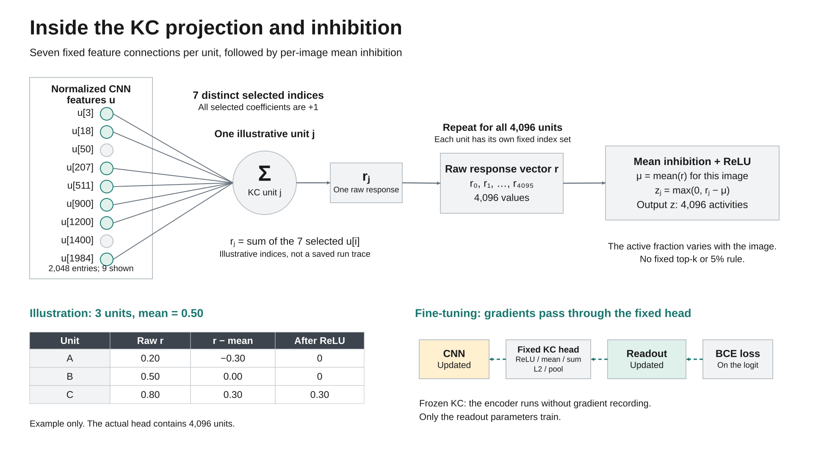

# KC equations, worked examples and gradient flow

This file expands the operations in the local KC model. Start with
[the architecture guide](KCNET_EXPLAINED.md) for context. All examples below use
invented values to explain computation, not measured research results.

## 1. Notation and dimensions

We describe one image. The code computes the same operations independently for
every image in a batch. Indices here are zero-based to match PyTorch.

| Symbol | Meaning | Default |
|---|---|---|
| `f` | CNN feature map after three blocks | `128 x 28 x 28` |
| `x` | Pooled, flattened feature vector | `d = 2048` values |
| `u` | L2-normalized feature vector | `d = 2048` values |
| `K` | Number of KC units | `4096` |
| `q` | Selected features per unit | `7` |
| `S_j` | Set of input indices selected for unit `j` | `q` distinct indices |
| `r` | Responses before inhibition | `K` values |
| `mu` | Mean response for this image | One scalar |
| `z` | KC activity after inhibition and ReLU | `K` values |
| `w`, `b` | Learned readout weights and bias | `K` weights and one bias |
| `ell` | Binary output logit | One scalar |
| `y` | Label | `0 = nature`, `1 = ai` |

## 2. Forward equations



This diagram shows seven selected inputs for one illustrative KC unit, followed
by repetition across all 4,096 units. Gray unconnected input entries are omitted
from that unit's sum. The numerical table is a synthetic three-unit example.
The dashed arrows describe backpropagation in the fine-tuned variant. Both
diagram pages can be edited in the [draw.io source](figures/kcnet_model.drawio).

### Pool and flatten

The encoder produces a 128x28x28 feature map. Adaptive average pooling produces
128x4x4 values, then flattening gives:

$$
x = \operatorname{flatten}(\operatorname{AvgPool}_{4\times4}(f)),
\qquad x \in \mathbb{R}^{2048}.
$$

At the default sizes, each 4x4 pooling cell averages a 7x7 region within one
channel. No learned parameter belongs to this pooling operation.

### Normalize

$$
u = \frac{x}{\max(\|x\|_2,\epsilon)},\qquad \epsilon=10^{-8}.
$$

For a nonzero vector with norm above the floor, `||u||_2 = 1`. A zero vector
remains zero. A vector below the floor is divided by `epsilon`, so its normalized
norm can be less than one. The floor is a numerical safeguard, not a trainable
threshold.

### Select and sum

For every unit `j`, choose `q` distinct indices once:

$$
S_j \subseteq \{0,\ldots,d-1\},\qquad |S_j|=q.
$$

The unit's raw response is:

$$
r_j = \sum_{i\in S_j} u_i.
$$

Every selected coefficient is +1. The model performs a sum, not a mean and not a
learned weighted sum. The index sets can overlap between units.

Equivalently, define a conceptual binary matrix `P` with shape `[K, d]`:

$$
P_{ji}=\begin{cases}1,&i\in S_j,\\0,&i\notin S_j,\end{cases}
\qquad r=Pu.
$$

The actual implementation stores only the selected integer indices, not this
dense matrix. `P` is a convenient mathematical description.

### Inhibit and rectify

$$
\mu = \frac{1}{K}\sum_{j=0}^{K-1}r_j,
\qquad a_j=r_j-\mu,
\qquad z_j=\max(0,a_j).
$$

The mean belongs to one image's KC responses. It is not a batch statistic.
Only above-mean responses remain positive. The number of positive outputs is
input-dependent; these equations do not impose top-k selection.

### Read out and classify

$$
\ell=w^\top z+b,
\qquad p_{AI}=\sigma(\ell)=\frac{1}{1+e^{-\ell}}.
$$

The per-image binary cross entropy is:

$$
L=-y\log p_{AI}-(1-y)\log(1-p_{AI}).
$$

The trainer calls `BCEWithLogitsLoss` on `ell` directly for numerical stability.
Its default reduction averages losses over the batch. Predict AI only when
`p_AI > 0.5`, equivalently `ell > 0`. An exact tie is real under the current rule.

## 3. A complete small forward example

To keep the arithmetic visible, use `d = 4`, `K = 3` and `q = 2`. The real
configuration is `d = 2048`, `K = 4096`, `q = 7`.

### Input normalization

Let the pooled feature vector be:

```text
x = [3, 4, 0, 0]
||x||_2 = sqrt(3^2 + 4^2) = 5
u = [0.6, 0.8, 0, 0]
```

### Fixed index sets

Choose these illustrative connections:

```text
S_0 = {0, 1}
S_1 = {1, 2}
S_2 = {2, 3}
```

The conceptual projection matrix is:

```text
P = [[1, 1, 0, 0],
     [0, 1, 1, 0],
     [0, 0, 1, 1]]
```

Now sum the selected features:

```text
r_0 = 0.6 + 0.8 = 1.4
r_1 = 0.8 + 0.0 = 0.8
r_2 = 0.0 + 0.0 = 0.0
```

### Inhibition and ReLU

```text
mu = (1.4 + 0.8 + 0.0) / 3 = 0.733333...
a = [0.666667..., 0.066667..., -0.733333...]
z = [0.666667..., 0.066667..., 0]
```

Two units survive. This illustrates why the active fraction is not necessarily
50%. A different feature vector can produce a different active set using the
same connections.

### Binary prediction

Let the readout be:

```text
w = [1.5, -0.5, 2.0]
b = -0.2
```

Then:

```text
ell = 1.5*(2/3) - 0.5*(1/15) + 2.0*0 - 0.2
    = 23/30 = 0.766667...
p_AI = sigmoid(ell), approximately 0.683
```

The toy classifier predicts AI. If the correct label is AI, its BCE loss is
approximately 0.382. These values are synthetic arithmetic examples, not the
performance or calibration of a trained model.

## 4. The three-unit example in presentation slide 7

The presentation starts at the response vector rather than showing the preceding
pooling and projection calculation:

```text
r = [0.20, 0.50, 0.80]
mu = 0.50
a = [-0.30, 0, 0.30]
z = [0, 0, 0.30]
```

The middle unit is exactly at the mean, so its activity is zero. This example
shows the inhibition operation. It does not describe the real model's number of
units or a measured activation trace.

## 5. Mapping the equations to the actual code

The relevant method is `FixedFilterKCNet.project_features()` in
[networks/kcnet.py](../networks/kcnet.py). Its core operations are:

```python
normalized = features / features.norm(p=2, dim=1, keepdim=True).clamp_min(epsilon)
responses = normalized[:, self.projection_indices].sum(-1)
activity = F.relu(responses - responses.mean(dim=1, keepdim=True))
```

For `features.shape == [B, 2048]` and `projection_indices.shape == [4096, 7]`:

1. Normalization returns `[B, 2048]`; each row is an image.
2. Indexing gathers `[B, 4096, 7]` values.
3. `sum(-1)` adds the seven values and returns `[B, 4096]`.
4. `mean(dim=1, keepdim=True)` returns `[B, 1]`.
5. Broadcasting subtracts each image's mean from its own 4,096 responses.
6. ReLU returns `[B, 4096]`, followed by the readout's `[B, 1]` logits.

The input sum and inhibition are calculated in float32 for half/bfloat16 feature
inputs. They are not detached in the fine-tuned model. The encoder's gradient
mode is controlled by `train_cnn` and the surrounding training/evaluation mode.

## 6. Backpropagation through the fixed head

The following derivatives describe data loss for one image. Batch averaging,
gradient clipping and AdamW affect the final training update. The equations are
not a claim that the code applies a plain SGD step.

### Readout gradients

For sigmoid/BCE:

$$
\delta=\frac{\partial L}{\partial\ell}=p_{AI}-y.
$$

Therefore:

$$
\frac{\partial L}{\partial w_j}=\delta z_j,
\qquad \frac{\partial L}{\partial b}=\delta,
\qquad \frac{\partial L}{\partial z_j}=\delta w_j.
$$

An active KC unit can contribute to the readout weight's data gradient. A zero
activity gives zero data gradient for its readout weight on that image. AdamW
weight decay or optimizer history can still affect the actual update.

### Mean inhibition couples the units

Let `m_j = 1` when `a_j > 0` and zero otherwise. At exactly zero, the PyTorch ReLU
backward convention used by this implementation gives zero local slope.
If `g_j = partial L / partial z_j`, then:

$$
\frac{\partial L}{\partial r_k}
=m_k g_k-\frac{1}{K}\sum_{j=0}^{K-1}m_j g_j.
$$

The first term is the direct path through unit `k`. The second term comes from
the shared mean. It affects every raw response, including responses whose own
rectified outputs are zero. Thus, "an inactive unit has no gradient anywhere"
would be incorrect for this head.

For the slide example, use illustrative readout weights `w = [1, -2, 3]`,
`b = -0.1` and label `y = 1`:

```text
z = [0, 0, 0.3]
ell = 3*0.3 - 0.1 = 0.8
p_AI approximately 0.689974
delta approximately -0.310026
active mask = [0, 0, 1]
direct active gradient = [0, 0, -0.930077]
gradient with respect to r approximately [0.310026, 0.310026, -0.620051]
```

The first two raw responses receive a gradient through the mean, despite their
zero activities. The response gradients sum to zero because adding the same
constant to every response leaves the centered responses unchanged.

### Fixed sums still differentiate their inputs

For the conceptual fixed matrix `P`:

$$
\nabla_u L=P^\top\nabla_r L.
$$

A selected feature receives contributions from every unit that selected it.
The implementation's gather/sum backward performs that accumulation. The matrix
or its index sets do not need to be trainable for input gradients to exist.

### Normalization and pooling pass gradients onward

When `s = ||x||_2 > epsilon`, the L2-normalization Jacobian is:

$$
\frac{\partial u}{\partial x}
=\frac{I}{s}-\frac{xx^\top}{s^3}.
$$

Below the norm floor, the denominator is fixed at `epsilon`, and the local
Jacobian is `I / epsilon`. The boundary itself is handled by autograd's
piecewise-operation conventions. Pooling distributes gradients to the CNN
feature-map values that contributed to each average.

In `finetuned_cnn_kcnet`, this chain reaches the CNN convolutional parameters.
In `fixed_filter_kcnet`, the encoder path runs without gradient recording; only
the readout gets parameter gradients. Both variants keep gradient-filter
coefficients and projection indices fixed.

## 7. Important edge cases and interpretation

| Case | Consequence |
|---|---|
| Zero pooled vector | Normalized features, responses and activities are all zero; logit equals the readout bias |
| All unit responses equal | Mean subtraction gives all zeros, even for a nonzero input |
| A response equals the mean | Its rectified activity is zero |
| Change projection seed | Changes the fixed feature combinations and therefore the model definition |
| Change `kc_units` | Changes mean inhibition, readout size and representation; it is not just adding independent votes |
| Change `fan_in` | Changes combinations, response statistics and connectivity |
| Change pool size | Changes spatial compression and feature dimension |

Mean subtraction alone has no learned scale, shift or variance division. It
should not be described as a full learned LayerNorm or BatchNorm layer. KC activity
is a feature vector, not a probability vector and not a set of class prototypes.

There are two separate learning questions: learning the CNN representation for a
fixed KC head, and learning the image-gradient filters. The current fine-tuned
KC model addresses the first. The existing learned-filter CNN addresses the
second. A combined architecture remains a future experiment.

## 8. Small runnable illustration

This snippet uses CPU tensors and no dataset or checkpoint. It verifies the
small forward calculation above. It does not train or evaluate a research model.

```python
import torch
import torch.nn.functional as F

x = torch.tensor([3.0, 4.0, 0.0, 0.0], dtype=torch.float64)
indices = torch.tensor([[0, 1], [1, 2], [2, 3]])
u = x / x.norm(p=2).clamp_min(1e-8)
r = u[indices].sum(-1)
z = F.relu(r - r.mean())
w = torch.tensor([1.5, -0.5, 2.0], dtype=torch.float64)
logit = (w * z).sum() - 0.2
label = torch.tensor(1.0, dtype=torch.float64)
loss = F.binary_cross_entropy_with_logits(logit, label)

print("normalized features:", u.tolist())
print("raw responses:", r.tolist())
print("KC activity:", z.tolist())
print("logit:", logit.item())
print("AI probability:", logit.sigmoid().item())
print("BCE:", loss.item())
```

For presentation wording, explain the operations in this order: normalize the
CNN features, add seven selected values per unit, suppress below-average
responses, and learn a binary readout. Then distinguish the two gradient modes.
